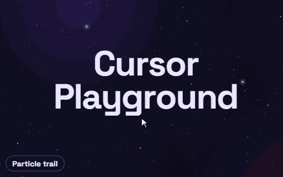

# Cursor Playground

Stack colorful effects on your cursor, tweak them, and share a link to what you made.

**Try it:** https://ethanmanco.github.io/cursor-playground/



## What it is

A small interactive toy set in deep space. Pick effects from the panel, mix several at once, and adjust each one with a couple of sliders. Everything you set is saved in the page link, so copying the address shares your exact setup. If you like one effect, **Copy code** gives you a standalone script to paste into your own site.

It works with a mouse, a finger, or a pen.

## The 25 effects

| Category | Effect | What it does |
| --- | --- | --- |
| Your cursor | Custom cursor | Swap the arrow for a rocket, UFO, orb, ring, or star |
| Followers | Particle trail | Glowing sparks spill out behind your cursor |
| Followers | Glowing comet | A bright comet chases your cursor on a spring |
| Followers | Ribbon snake | A wiggly space snake slithers after you |
| Followers | Watching eyes | Eyes around the screen follow you, and sometimes blink |
| Followers | Fireflies | Hold still and fireflies gather around you; move fast to scatter them |
| Followers | Orbiting moons | Little moons circle your cursor and trail along behind you |
| Followers | Boids flock | A flock of tiny ships follows you; press to scatter them |
| Drawing | Fading ink | A brush-pen line that thins when you move fast, then fades |
| Drawing | Rainbow paint | Paint with a brush that cycles through the rainbow |
| Psychedelic | Color trip | Slowly rolls every color on screen around the rainbow |
| Psychedelic | Lava lamp | Glossy goo blobs drift, melt together, and follow you (WebGL) |
| Psychedelic | Moire rings | Two sets of rings overlap into wobbly op art patterns |
| Psychedelic | Echo cursors | Rainbow ghost cursors replay your moves a beat behind |
| Background | Aurora | Soft northern lights ripple across the sky and lean toward you |
| Background | Starfield warp | Fly through space toward your cursor; move fast to boost |
| Background | Parallax drift | Layers of space dust drift by and shift as you move |
| Background | Ripple grid | A field of dots bends away from you; clicks send a ripple |
| Background | Constellations | Drifting stars link up and reach out to your cursor |
| Lighting | Flashlight | Lights out; explore a hidden star map where found stars stay lit and finished constellations draw in; click for a flare |
| Physics | Gravity well | Your cursor pulls in drifting motes; hold down to push them away |
| Click | Firework burst | Click or tap anywhere to set off a burst |
| Click | Soap bubbles | Press and hold to blow bubbles; touch them to pop them |
| Click | Confetti pop | Click or tap to throw a handful of fluttering confetti |
| Click | Shockwave | Click or tap to send a glowing ring rushing outward |

There are also 11 presets and a **Randomize** button.

More to play with:

- **Autopilot:** if nobody moves for a few seconds, a ghost cursor takes over and shows the effects off. Any real move takes back control. You can switch it off in the panel.
- **Save picture:** download a PNG of what is on screen.
- **My mixes:** save setups you like. They stay in your browser, ready to bring back with one click.
- **Zen mode:** hide the panel for a clean view. Press Escape or **Show panel** to bring it back.
- **Share links and Copy code**, described below.
- The title says hello, then fades after 3 seconds so it stays out of the way.

## Run it locally

```bash
npm install
npm run dev      # http://localhost:5173
npm test         # unit tests for share links, presets, and settings
npm run build    # type-check and build to dist/
```

Pushing to `main` deploys to GitHub Pages through `.github/workflows/deploy.yml`.

## How it works

- **Vite + TypeScript**, drawn with **Canvas 2D**. No UI framework. The lava lamp is the one effect that uses **WebGL**, because a per-pixel shader makes its glossy goo smooth and fast; it falls back to soft circles without WebGL.
- **One shared animation loop** runs every effect. It sleeps when nothing is on and pauses while the tab is hidden.
- **Two canvas layers** sit behind and in front of the title, so background effects stay behind the text.
- **A shared particle budget** (1500 on desktop, 500 on touch devices) keeps phones smooth no matter how many effects you stack.
- **Pointer Events** handle mouse, touch, and pen the same way.
- **Share links** live in the part of the URL after `#`, for example `#v1~trail_6ee7ff_14_5~paint_12_5_4`. Each item is an effect id followed by its settings in order. Bad or missing values fall back to safe defaults.
- **Copy code** comes from the same source as the page. At build time a small Vite plugin (`tools/snippets-plugin.ts`) bundles each effect with a tiny host script, and the page fills in your current settings when you copy.

## Accessibility

- If your device asks for reduced motion, every effect starts off and a notice explains why. Shared links show a **Turn them on** button instead of starting by themselves.
- The panel uses real labels, switches, and buttons, works fully from the keyboard, and shows a clear focus ring.
- On phones the panel becomes a bottom sheet that starts closed.
- Copied scripts also stay off for visitors who prefer reduced motion.
- Nothing flashes. The psychedelic effects shift hue and move smoothly, but never strobe or flicker in brightness, so they stay clear of the photosensitivity limits in WCAG 2.3.

## Add a new effect

1. Create `src/effects/<id>.ts`. The file name must match the effect `id`, because **Copy code** finds effects by file name.
2. Export an object that follows the `Effect` interface from `src/engine/types.ts`:

```ts
import type { Effect } from '../engine/types';

type S = { color: string; size: number };

export const sparkle: Effect<S> = {
  id: 'sparkle',                      // short and stable, used in share links
  name: 'Sparkle',
  blurb: 'One short sentence for the panel.',
  category: 'followers',              // decides which panel group it joins
  layer: 'front',                     // 'back' draws behind the title
  settings: [                         // 2 or 3 controls: 'range', 'color', or 'choice'
    { kind: 'color', key: 'color', label: 'Color', default: '#6ee7ff' },
    { kind: 'range', key: 'size', label: 'Size', min: 2, max: 20, step: 1, default: 8 },
  ],
  setup(env, s) {},                   // called when switched on
  update(dt, env, s) {},              // move things; dt is in seconds
  draw(env, s) {},                    // draw on env.front or env.back
  onPointerDown(env, s) {},           // optional: clicks and taps
  teardown(env) {},                   // give back env.budget, undo DOM changes
};
```

3. Add it to the list in `src/effects/index.ts`. The panel, share links, presets, Randomize, and Copy code all pick it up from there.
4. Run `npm test`. The tests check that ids match file names and that every setting has a valid default.

A few tips:
- Ask `env.budget.take(n)` before creating particles and `give` them back when they die.
- Keep settings in the order you first published them. Add new ones at the end so old share links keep working.
- `env.pointer` gives you `x`, `y`, the previous frame's `px`, `py`, velocity, and whether it is `down` or `inside` the page.

## Future ideas

Not in this version:

- Accounts and saved favorites
- A gallery of setups other people made
- Uploading your own image for the flashlight to reveal
- Sound
- More effects:
  - Magnetic buttons
  - Magnifier lens

## Credits

Built with Claude Code. I designed, directed, reviewed, and tested it.
